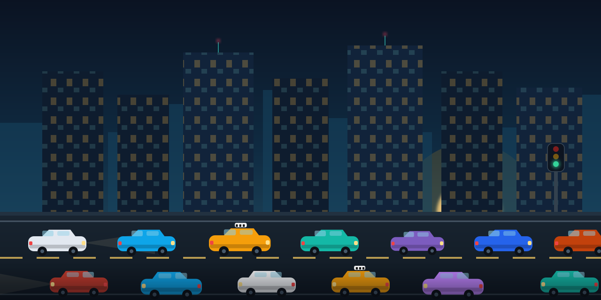
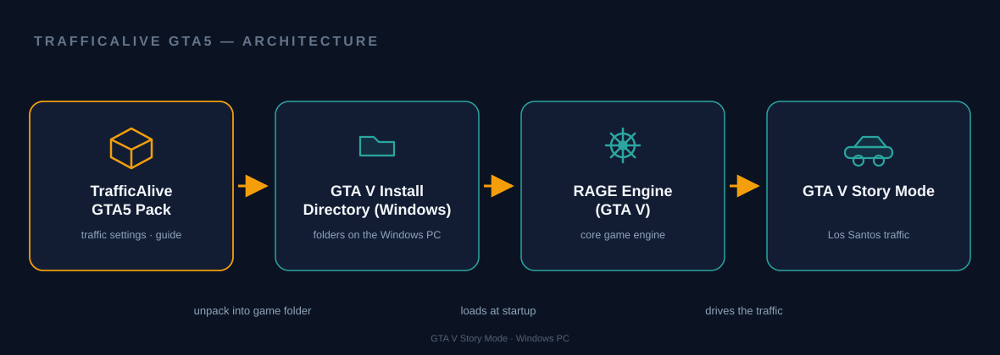

# TrafficAlive GTA5

**A realistic traffic tuning pack that makes Los Santos feel busy, believable and immersive in GTA V Story Mode — richer traffic density, smarter vehicle behavior and fuller road activity on Windows.**

[download-url]: https://github.com/traffic-alive-gta5/releases

     

[][download-url]

## Why

Vanilla traffic in GTA V Story Mode can feel thin: empty avenues, repetitive vehicle patterns and AI drivers that behave the same on every street. That quietly drains the atmosphere of Los Santos — a megapolis needs to feel alive before everything else becomes believable. TrafficAlive GTA5 delivers a prepared realistic traffic setup: tuned traffic density, more natural vehicle behavior and richer city, urban and highway activity, so an ordinary drive turns into an immersive experience without tipping into needless chaos.

## Without / With

| Without | With |
|---|---|
| Sparse, repetitive road traffic breaks the immersion | Busy, believable streets welcome you back to the city |
| AI vehicles behave the same everywhere | Vehicle movement reads as natural and varied |
| Highways and intersections feel lifeless | Road activity keeps pace with the city around it |
| Endless manual trial-and-error with traffic settings | A prepared realistic setup with clear tuning guidance |
| Los Santos feels like a backdrop, not a city | Driving through Los Santos becomes the experience itself |

## Quick Start

1. Save the release package to your Downloads folder via [Download][download-url].
2. Back up the Grand Theft Auto V game folder before changing anything (adjust the path if your game is installed elsewhere):
   `powershell Copy-Item "C:\Program Files\Rockstar Games\Grand Theft Auto V" "$env:USERPROFILE\Desktop\GTA-V-Backup" -Recurse`
3. Open the Downloads folder, unpack the package and follow the included installation instructions step by step:
   `powershell Start-Process explorer.exe "$env:USERPROFILE\Downloads"`
4. Launch GTA V Story Mode, take a short drive through Los Santos and tune the configuration to your preferred experience (see Configuration).

## Features

- Tune traffic density for busier, more immersive Los Santos streets.
- Improve AI vehicle behavior for natural, believable road movement.
- Increase vehicle variety across city, urban and highway routes.
- Balance city and highway activity for a consistent traffic picture.
- Configure time-based traffic for different times and story-mode situations.
- Keep emergency vehicle presence visible yet balanced where supported.
- Follow a clear Windows-focused installation and tuning guide.

## How it works

The scheme traces the path from package to living city: the TrafficAlive GTA5 Pack is unpacked into the GTA V Install Directory on a Windows PC, the RAGE Engine loads the tuned traffic settings at startup, and the result — fuller, believable traffic — plays out in GTA V Story Mode across Los Santos.

## Usage

- Busier downtown mornings: install the pack, launch Story Mode in Los Santos in the late morning and enjoy noticeably denser street traffic around the usual vanilla lulls.
- Calm late-night drives: lean on the time-based side of the configuration so night roads stay convincing and calm instead of empty or overloaded.
- Highway realism run: take a full freeway loop around Los Santos to check highway flow variety and the balance of emergency vehicle presence on longer routes.

## Configuration

| Setting | What it controls | How to tune |
|---|---|---|
| Traffic density | How full streets, intersections and highways feel | Change the value slightly, take a test drive in Story Mode, then step again |
| Vehicle behavior | How AI vehicles act on roads | Adjust one behavior aspect at a time and watch for natural reactions |
| Time-based traffic | Traffic around different times and situations | Tune busy daytime hours and calmer night settings separately |
| Emergency vehicles | Presence of emergency traffic where supported | Keep it noticeable but balanced so the city stays believable |
| Road activity | Flow variety across city and highway routes | Aim for the same believable rhythm on every route you set up |

## Troubleshooting / FAQ

**Traffic looks unchanged after installation.** Re-read the included installation instructions — the pack needs to land in the appropriate GTA V directories, and the game must be started fresh for new traffic settings.

**Windows marks the downloaded file as blocked.** Right-click the file → Properties → Unblock before unpacking.

**My game is installed in a different folder.** Adjust the paths in the Quick Start commands to your real GTA V install directory.

**Traffic feels too chaotic.** Step the density changes back until the picture stays busy yet believable — the goal is immersive traffic, not a mess.

**Can this be used in GTA Online?** No — TrafficAlive GTA5 targets GTA V Story Mode; keep modded traffic settings out of multiplayer.

## Contributing

Issues and pull requests are welcome: story-mode drive reports (route, time of day, how the traffic felt), wording improvements for the installation guide, and documentation polish are the most useful contributions. If TrafficAlive GTA5 makes your Los Santos feel alive, star the repository — every star helps other GTA V players find it.

## Keywords

gta5 traffic mod · gta5 realistic traffic · gta5 traffic density · gta5 ai traffic · gta5 immersive traffic · gta5 traffic settings · gta5 traffic tuning · gta5 story mode · gta5 vehicle traffic · gta5 city traffic · gta5 traffic 2026 · gta5 driving realism · gta5 highway traffic · gta5 urban traffic · gta5 vehicle behavior · gta5 traffic customization · gta5 immersive driving · gta5 road activity · gta5 traffic pack · gta5 single player · realistic traffic · traffic density mod · traffic behavior · realistic driving · immersive driving · driving immersion · driving experience · story mode traffic · single player mod · traffic enhancement · road traffic · vehicle variety · traffic ai · city traffic simulation · highway traffic flow · urban traffic activity · emergency vehicles traffic · los santos · believable traffic · lively city streets · traffic experience · traffic realism suite · traffic tuning guide · traffic settings pack · vehicle behavior tuning · traffic density settings · time-based traffic · traffic customization pack · traffic atmosphere · gta v story mode · gta v traffic · gta 5 mod · gta 5 2026 · gta v mods · traffic mod windows · windows gaming · traffic simulation pack · free traffic mod · single player driving

## License

Released under the [MIT](./LICENSE) license.
